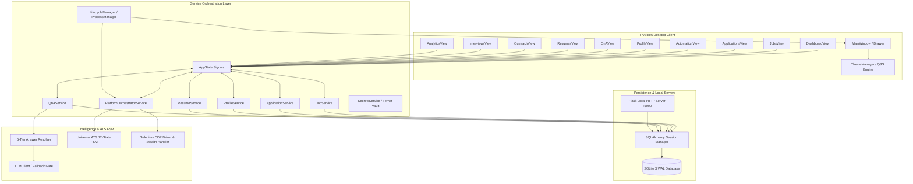
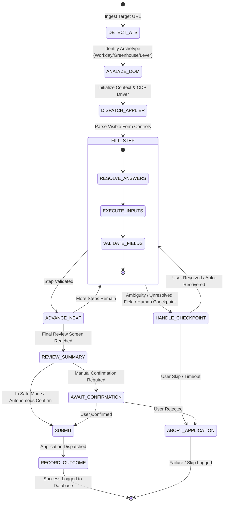
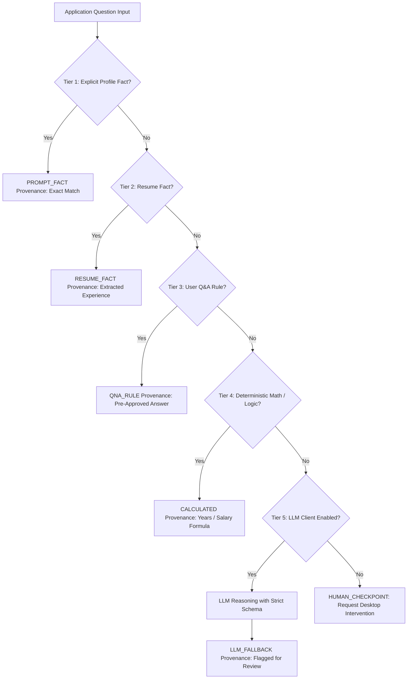

# JobPilot — Technical Requirements Document (TRD)

**Document Identifier:** `JOBPILOT-DOC-02-TRD`  
**Classification:** Proprietary / Engineering Specification  
**Version:** 1.0.0-PROD  
**Target Release:** JobPilot v0.1.0-beta.1 Desktop Runtime  
**Lead Architect:** Principal System Architect & Lead Engineer  
**Date:** November 2026  

---

## 1. Technical Overview

JobPilot is architected as an autonomous, cross-platform desktop automation client with local embedded services. The system is engineered in Python 3.11+ using PySide6 (Qt 6.7+) for its presentation layer, SQLAlchemy 2.0 ORM with SQLite 3 in Write-Ahead Logging (WAL) mode for persistence, Selenium WebDriver with Chrome DevTools Protocol (CDP) for stealthy browser automation, and a local Flask management service for headless diagnostics and local REST interoperability.

The application adheres to strict architectural isolation:
1. **User Interface (`app/ui/`):** Asynchronous event-driven PySide6 desktop views bound to services via signals/slots or `AppState`.
2. **Domain Service Layer (`app/services/`):** 24 specialized domain services executing business logic, session governance, cryptography, and orchestration.
3. **Data Access Layer (`app/db/`):** SQLAlchemy ORM models, session context managers, schema migration safeguards, and connection pooling.
4. **Platform Automation Engines (`platforms/`, `modules/`):** Specialized web drivers and a 12-state finite-state machine (FSM) targeting major job platforms and enterprise ATS portals.
5. **Deterministic Intelligence Layer (`app/services/qna_service.py`, `app/services/llm_client.py`):** Multi-tier knowledge graph routing questions through deterministic profiles, resumes, and cached rules before invoking rate-limited LLM fallbacks.

---

## 2. Technology Stack & Runtime Dependencies

### 2.1 Core Runtime Specifications
- **Programming Language:** Python 3.11.16+
- **GUI Framework:** PySide6 6.7.0+ (Qt 6.7 Core, Gui, Widgets, Svg)
- **Persistence Engine:** SQLite 3.42+ with WAL journaling mode
- **ORM & Data Mapping:** SQLAlchemy 2.0.25+
- **Browser Automation:** Selenium 4.25.0+ with undetected-chromedriver and Chrome DevTools Protocol (CDP)
- **Local Management Web Server:** Flask 3.0.0+, Werkzeug 3.0.0+
- **Cryptography & Security:** Cryptography (Fernet symmetric 256-bit AES-CBC with HMAC-SHA256)
- **Document Processing:** pdfplumber 0.11+, pypdf 4.0+, python-docx 1.1+
- **AI / LLM Clients:** Google GenAI / Gemini SDK (`google-genai`), Groq SDK (`groq`), OpenAI SDK (`openai`), Ollama REST integration
- **Packaging & Distribution:** PyInstaller 6.6+, Inno Setup (Windows), AppImage / DEB / TAR.GZ (Linux)

### 2.2 Directory & Module Mapping

```
JobPilot/
├── app.py                      # Flask background management & REST server
├── run_desktop.py              # Main desktop GUI launcher & application lifecycle manager
├── runAiBot.py                 # CLI orchestration entry point & headless execution runner
├── app/
│   ├── config.py               # Central environment, path, and configuration settings
│   ├── db/
│   │   ├── session.py          # SQLite engine lifecycle, WAL mode PRAGMA, scoped sessions
│   │   └── models/             # 16 SQLAlchemy declarative database models
│   ├── services/               # 24 core domain and orchestration services
│   └── ui/                     # PySide6 desktop presentation layer
│       ├── main_window.py      # Primary host window, navigation drawer, theme injection
│       ├── theme_manager.py    # JobPilot design token engine (Dark/Light themes)
│       └── views/              # 13 dedicated functional views
├── platforms/                  # Platform-specific automation drivers
│   ├── linkedin/               # LinkedIn Easy Apply driver & selectors
│   ├── naukri/                 # Naukri automation driver & profile sync
│   ├── indeed/                 # Indeed automation driver
│   ├── glassdoor/              # Glassdoor scraper and applier
│   └── universal/              # ATS Archetype detector & Universal FSM Applier
├── modules/                    # Shared operational engines (browser, Q&A, rate limits)
└── config/                     # YAML/JSON application defaults & credentials blueprints
```

---

## 3. High-Level System Architecture

JobPilot decouples long-running browser processes and background workers from the user interface using asynchronous worker threads (`QThread` / `TaskRunner`) and Qt event queues.



---

## 4. Frontend Architecture (PySide6 MVVM & Event Loop)

### 4.1 UI Thread Safety & Asynchronous Dispatch
To ensure 60 FPS desktop fluidity and complete immunity against UI thread freezes:
- All database mutations, Selenium browser commands, HTTP requests, and PDF document parsing execute strictly in worker threads managed by `TaskRunner` or dedicated `QThread` instances.
- Background threads communicate status updates, log events, and job discoveries back to UI widgets exclusively via Qt Signals and Slots (`pyqtSignal` / `Signal`).
- Worker threads never directly read from or mutate UI widget state.

### 4.2 State Management (`AppState`)
The `AppState` singleton (`app/ui/app_state.py`) acts as the reactive message bus across views. It exposes thread-safe Qt signals:
- `job_discovered(job_dict)`
- `application_state_changed(app_id, new_status)`
- `automation_status_changed(platform, run_state)`
- `checkpoint_requested(checkpoint_data)`
- `stats_updated(metrics_payload)`

### 4.3 View Architecture
Each of the 13 views inherits from `QWidget` and encapsulates:
1. **Model Binding:** Reads initialized data from services asynchronously upon activation (`showEvent`).
2. **Action Dispatch:** Invokes service layer methods wrapped in background tasks.
3. **Lifecycle Cleanup:** Overrides `closeEvent` and invokes `deleteLater()` on dynamic child widgets to prevent memory leaks during view transitions.

---

## 5. Domain Service Layer Architecture

JobPilot incorporates 24 specialized domain services in `app/services/`:

| Service Identifier | Module Path | Architectural Responsibility |
|---|---|---|
| `JobService` | `app/services/job_service.py` | Job ingestion, deduplication, match score calculation, filter queries. |
| `ApplicationService` | `app/services/application_service.py` | State machine transitions, submission history, application metrics. |
| `PlatformOrchestratorService` | `app/services/platform_orchestrator.py` | Multi-platform scheduling, concurrency arbitration, runner lifecycle. |
| `QnAService` | `app/services/qna_service.py` | 5-tier deterministic answer resolution, rule matching, provenance tracking. |
| `ProfileService` | `app/services/profile_service.py` | Candidate identity facts, work history, skills, compensation bounds. |
| `ResumeService` | `app/services/resume_service.py` | PDF parsing, section extraction, ATS keyword scoring, variant selection. |
| `SecretsService` | `app/services/secrets_service.py` | AES-256 Fernet encrypted credential vault, secure key derivation. |
| `LLMClient` | `app/services/llm_client.py` | Provider-agnostic LLM adapter (Gemini, Groq, OpenAI, Ollama). |
| `InterviewService` | `app/services/interview_service.py` | Interview schedule tracking, round management, prep question generation. |
| `OutreachService` | `app/services/outreach_service.py` | Recruiter contact CRM, communication logging, follow-up scheduling. |
| `AnalyticsService` | `app/services/analytics_service.py` | Conversion funnel analysis, daily velocity trends, platform comparison. |
| `ApplicationLifecycleManager`| `app/services/application_lifecycle.py` | Orderly shutdown sequence, thread reaping, connection pool disposal. |
| `ProcessManager` | `app/services/process_manager.py` | Process tree killing (`taskkill /F /T` / `os.killpg`), zombie cleanup. |
| `SystemService` | `app/services/system_service.py` | Cross-platform directory opening, clipboard access, shell isolation. |
| `BackupService` | `app/services/backup_service.py` | Database export, automated snapshots, atomic restore verification. |
| `URLSecurityValidator` | `app/services/url_validator.py` | Domain safety checks, redirect sanitization, malicious URL filtering. |
| `InboundSyncService` | `app/services/inbound_sync_service.py` | IMAP 2-way Gmail sync, reply detection, sync label checkpointing. |
| `FollowUpScheduler` | `app/services/followup_scheduler.py` | Automated multi-touch email follow-up cadences and pause safeguards. |

---

## 6. Automation Engine & Finite-State Machine (FSM)

The Universal ATS engine (`platforms/universal/`) dynamically interrogates web application forms and navigates complex multi-step application funnels through a formal 12-state FSM:



### 6.1 Supported ATS Archetypes
- **Workday:** Dynamic shadow DOM elements, paginated review cards, nested iframe inputs.
- **Greenhouse:** Single-page reactive forms, custom file drag-and-drop zones, nested dropdowns.
- **Lever:** Fast multi-input forms, LinkedIn profile URL autofill, resume drag-and-drop.
- **Ashby:** Complex React components, shadow input wrappers, dynamic salary questions.
- **SmartRecruiters:** Stepped modal navigation, complex verification fields.
- **Generic Fallback:** Heuristic DOM scanner analyzing label semantic proximity, placeholder clues, and input type attributes.

---

## 7. Multi-Tier Q&A Intelligence Engine

To guarantee zero hallucinations and eliminate incorrect submissions, answers to employer application questions are computed strictly through a prioritized 5-tier fallback cascade:



Every resolved answer is stamped with its source provenance (`PROFILE_FACT`, `RESUME_FACT`, `QNA_RULE`, `CALCULATED`, or `LLM_FALLBACK`) and stored in the database. If confidence falls below 0.85 and safe mode is active, the engine pauses and requests user confirmation via the UI checkpoint drawer.

---

## 8. Database Architecture & Concurrency Rules

### 8.1 SQLite Write-Ahead Logging (WAL) Configuration
To allow high-throughput background automation logging concurrently with interactive GUI queries without lock contention:
```sql
PRAGMA journal_mode = WAL;
PRAGMA busy_timeout = 30000;
PRAGMA synchronous = NORMAL;
PRAGMA foreign_keys = ON;
```

### 8.2 Session Lifecycle Rules
- Database sessions must be short-lived. Holding a transaction open across browser actions, network requests, or sleeps is strictly prohibited.
- Worker threads obtain scoped sessions via the `get_db_session()` context manager (`app/db/session.py`), ensuring automatic commits and disposal.
- The engine supports explicit connection disposal via `dispose_engine()` during application lifecycle teardown.

---

## 9. Security, Privacy & Compliance Architecture

1. **Zero Secret Hardcoding:** API keys and credentials are encrypted using Fernet symmetric encryption with 256-bit AES in CBC mode and HMAC-SHA256 authentication (`app/services/secrets_service.py`).
2. **Log Sanitization:** All console streams, log files, and crash dumps pass through `LogSanitizer.sanitize_text()`, redacting emails, tokens, session cookies, and passwords via regex filters.
3. **Fail-Closed Operations:** If an unexpected form state or high-risk field (e.g. background check authorization or legal declaration) appears, automation enters `STATUS_UNKNOWN` or triggers a human checkpoint.
4. **Anti-Evasion Integrity:** The system never deploys automated CAPTCHA solving or stealth fingerprint bypasses. CAPTCHA challenges require human completion.
5. **Restricted Shell Execution:** Shell commands are strictly executed without `shell=True` using sanitized argument arrays to prevent command injection.

---

## 10. Packaging & Cross-Platform Distribution

The application is compiled and distributed using PyInstaller with platform-specific packaging manifests:
- **Windows:** Bundled into a standalone executable (`JobPilot.exe`) and an Inno Setup installer package (`JobPilot-Setup-v0.1.0-beta.exe`).
- **Linux:** Packaged as an AppImage binary and Debian package (`.deb`) supporting Ubuntu 22.04+ and Debian 12+.
- **Asset Ingestion:** Icons, SVG brand symbols, splash screens, and default CSS files are compiled via Qt Resource files (`resources.qrc` / PySide6 rcc) or resolved dynamically via `AppPaths.get_resource_dir()`.

---

## 11. Traceability & Source Code References

| Architecture Component | Implementation File References |
|---|---|
| Desktop GUI Host & Lifecyle | `run_desktop.py`, `app/ui/main_window.py`, `app/services/application_lifecycle.py` |
| Design Tokens & Themes | `app/ui/theme_manager.py`, `app/ui/styles/` |
| Persistence & Models | `app/db/session.py`, `app/db/models/` (16 models) |
| Multi-Platform Engines | `platforms/linkedin/`, `platforms/naukri/`, `platforms/indeed/`, `platforms/universal/` |
| Q&A Provenance & Routing | `app/services/qna_service.py`, `app/services/llm_client.py` |
| Secrets & Security Vault | `app/services/secrets_service.py`, `modules/security/` |
| Management Web Server | `app.py`, `modules/server/` |

