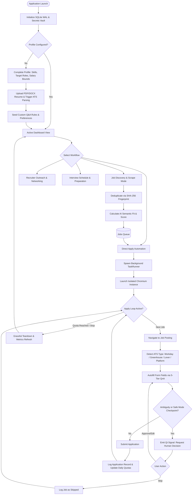
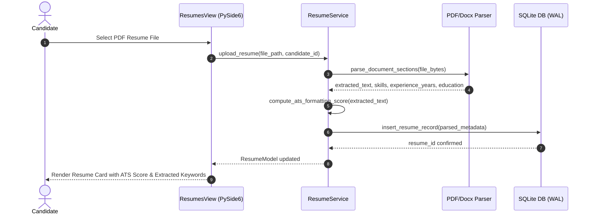
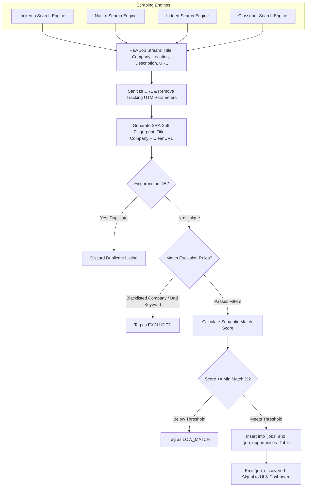
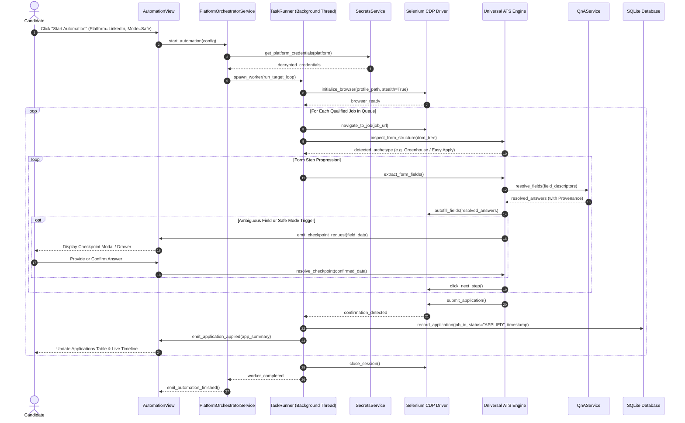
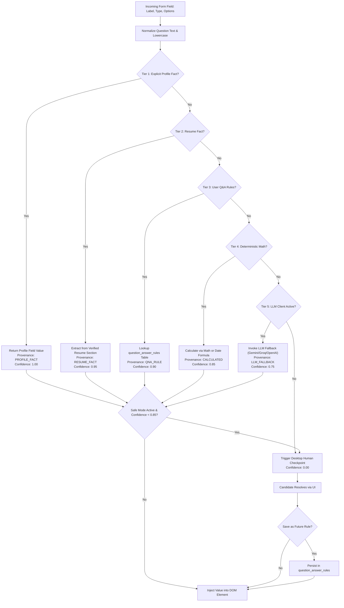
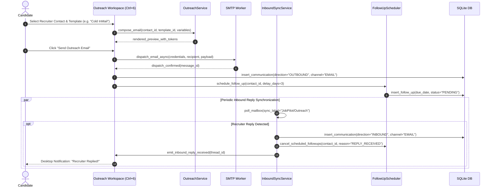
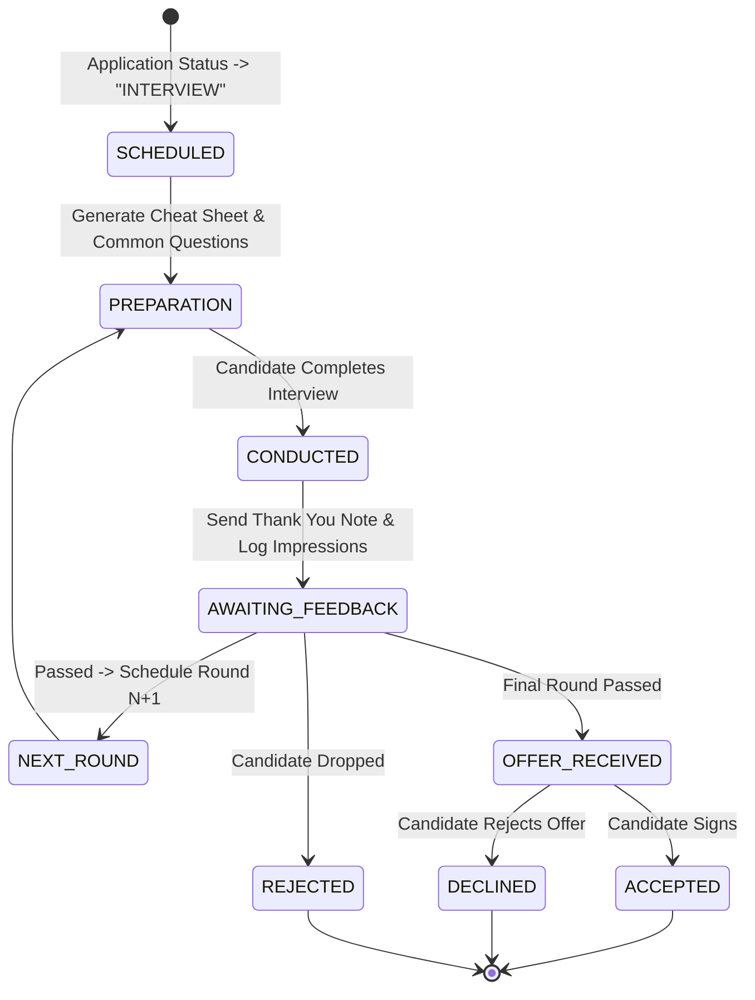
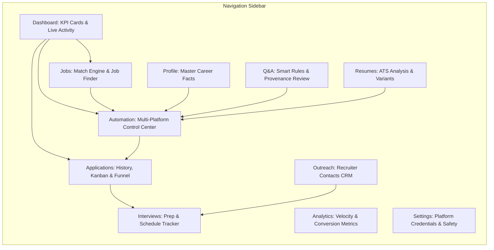

# JobPilot — Application Flow Specification

**Document Identifier:** `JOBPILOT-DOC-03-FLOW`  
**Classification:** Proprietary / Engineering Specification  
**Version:** 1.0.0-PROD  
**Target Release:** JobPilot v0.1.0-beta.1  
**Lead Architect:** Principal Solutions Architect & Interaction Designer  
**Date:** November 2026  

---

## 1. Executive Workflow Overview

JobPilot coordinates candidate profiles, resume variants, platform automation engines, and deterministic AI scoring into a unified, high-reliability desktop application flow. The system operates locally on the user's workstation, maintaining local SQLite storage and initiating isolated, stealthy browser sessions under user-configured boundaries.

This document details the complete end-to-end operational workflows, sequence diagrams, state machines, and exception handling paths governing candidate and recruiter interactions.

---

## 2. End-to-End Candidate Lifecycle

The candidate lifecycle spans onboarding, profile configuration, automated job discovery, multi-platform applications, human checkpoint intervention, and post-submission interview tracking.

---

## 3. Candidate Journey (Step-by-Step Sequence)

### 3.1 Initial Setup and Resume Parsing Sequence
When a candidate adds a new resume, the file is parsed, indexed, and vectorized locally.

---

## 4. Job Discovery, Ingestion & Deduplication Flow

JobPilot ingests job listings from multiple sources (LinkedIn, Naukri, Indeed, Glassdoor, and custom search queries) and filters them using strict semantic rules and SHA-256 hashing.

---

## 5. Multi-Platform Application Execution Sequence

The application execution loop operates in an asynchronous worker thread, ensuring the desktop GUI remains responsive at 60 FPS while interacting with external browser instances.

---

## 6. 5-Tier Q&A Resolution & Provenance Flow

The Question & Answer engine routes application form questions through a zero-hallucination deterministic resolution hierarchy:

---

## 7. Email Outreach & Recruiter Follow-Up Workflow

JobPilot coordinates direct recruiter cold outreach, 2-way Gmail/IMAP synchronization, and automated multi-touch follow-ups through dedicated background workers.

---

## 8. Interview Preparation & Lifecycle Management

When an application converts into an interview, the interview lifecycle engine activates:

---

## 9. Error Handling, Exception Flows & Recovery

JobPilot incorporates fail-safe recovery patterns to handle network drops, platform changes, and system crashes gracefully:

| Error Condition | Trigger Point | Automated Recovery Protocol | Fail-Closed Fallback |
|---|---|---|---|
| **Rate Limit Triggered** | Platform HTTP 429 or search lock | Immediate worker backoff; pause platform automation for 60 minutes. | Notify candidate in UI; switch to secondary configured platform. |
| **CAPTCHA / Challenge** | Cloudflare Turnstile or platform puzzle | Halt worker thread immediately; sound desktop alert; focus browser window. | Candidate completes challenge manually; clicks "Resume" in UI. |
| **DOM Element Missing** | Selector change or dynamic JS load | Retry up to 3 times with exponential backoff and alternate XPath heuristics. | Mark step as ambiguous; trigger Human Checkpoint drawer. |
| **Database Lock / Busy** | SQLite simultaneous write collision | Automatically wait using SQLite `busy_timeout = 30000ms`. | Log retry; fail operation safely without data corruption. |
| **Abrupt App Termination** | Power loss or OS process kill | WAL journal automatically recovers uncommitted transactions on startup. | Re-open database cleanly; stale automation flags reset to `IDLE`. |
| **Browser Zombie / Orphan** | Desktop UI closed while worker active | `ApplicationLifecycleManager` terminates browser trees via `ProcessManager`. | Force kill child process tree (`taskkill /F /T` or `os.killpg`). |

---

## 10. Dashboard Navigation & Information Hierarchy

