# JobPilot — UI/UX Design Brief & Comprehensive Screen Inventory

**Document Identifier:** `JOBPILOT-DOC-04-UIUX`  
**Classification:** Proprietary / Design & Interface Specification  
**Version:** 1.1.0-PROD  
**Target Release:** JobPilot v0.1.0-beta.1 Desktop Runtime  
**Lead Designer:** Principal Product Designer & UI Architect  
**Date:** November 2026  

---

## 1. Product Design Direction & Human-Centered Philosophy

JobPilot's interface is crafted for candidates, career switchers, and power job seekers who require uncompromising transparency and deterministic control over their automated career pipelines. Rather than presenting automation as a fragile or mysterious black box, JobPilot's design system champions **Transparent Agency**: the candidate always commands full visibility over every identity fact, resume artifact, submitted questionnaire, and outgoing application.

### 1.1 Core Design Tenets
1. **Calm, High-Information Density:** Interfaces present rich telemetry, dense tabular job queues, and status metrics without visual clutter or overwhelming cognitive load.
2. **Deterministic Confidence:** Safety modes, answer provenance, and automation states are rendered with unambiguous color indicators and clear status badges.
3. **Ergonomic Desktop Fluidity:** Built natively with PySide6 (Qt 6.7), the desktop interface responds instantaneously, honoring 60 FPS rendering, keyboard navigation, and seamless fractional DPI scaling.
4. **Cohesive Visual Identity:** Grounded in a modern dark-first palette featuring Deep Obsidian (`#0F172A`), Safety Orange (`#FF5F15`), and Electric Sky Cyan (`#0EA5E9`), establishing a technical yet approachable aesthetic.

---

## 2. Design System & Token Architecture

JobPilot utilizes a 3-layer design token system managed dynamically by `ThemeManager` (`app/ui/theme.py`). Tokens define colors, typography, elevations, border radii, and spacing scales.

### 2.1 Color Palette & Semantic Roles

| Token Name | Hex Code | Visual Sample | Semantic Application |
|---|---|---|---|
| `--color-bg-primary` | `#0F172A` | `Dark Slate` | Root desktop background, main window frame canvas |
| `--color-bg-secondary` | `#1E293B` | `Obsidian Card` | Navigation sidebar, card containers, table headers |
| `--color-bg-tertiary` | `#334155` | `Slate Gray` | Input field backgrounds, secondary buttons, active item fills |
| `--color-primary-orange` | `#FF5F15` | `Safety Orange` | Primary brand accent, CTA buttons, active tab indicators |
| `--color-primary-hover` | `#E04F0B` | `Deep Amber` | Hover state for primary buttons and high-visibility actions |
| `--color-accent-cyan` | `#0EA5E9` | `Sky Cyan` | Secondary accents, metric highlights, link hovers |
| `--color-accent-hover` | `#0284C7` | `Deep Cyan` | Interactive states on cyan accents and badges |
| `--color-success` | `#10B981` | `Emerald` | Applied status, high match scores (>85%), successful sync |
| `--color-warning` | `#F59E0B` | `Amber Gold` | Checkpoint alerts, medium match (60-84%), pending review |
| `--color-danger` | `#EF4444` | `Rose Red` | Application failed, low match (<60%), rate limit tripped |
| `--color-text-primary` | `#F8FAFC` | `Pure Snow` | Primary headings, table values, prominent titles |
| `--color-text-secondary`| `#94A3B8` | `Muted Slate` | Subtitles, field labels, metadata timestamps, table headers |
| `--color-border` | `#334155` | `Border Slate` | 1px card outlines, divider lines, table cell borders |

### 2.2 Typography Scale
Typography is rendered using standard system-native sans-serif fonts (`Segoe UI`, `Inter`, `SF Pro Display`, `Ubuntu`, `Helvetica Neue`), with monospaced fallbacks (`JetBrains Mono`, `Consolas`, `monospace`) for code and token values.

| Type Scale Role | Font Size | Weight | Line Height | CSS / QSS Usage |
|---|---|---|---|---|
| **Display 1 (Hero)** | 24px | 700 (Bold) | 32px | View titles, splash headings |
| **Heading 1** | 20px | 600 (Semi-Bold) | 28px | Section headers, modal titles |
| **Heading 2** | 16px | 600 (Semi-Bold) | 24px | Card headers, table group titles |
| **Body Large** | 14px | 400 (Regular) | 20px | Primary card copy, active inputs |
| **Body Medium** | 13px | 400 (Regular) | 18px | Table rows, navigation items, list details |
| **Caption / Meta** | 11px | 500 (Medium) | 16px | Timestamps, badge labels, footers |
| **Code / Monospace** | 12px | 500 (Medium) | 16px | URLs, hashes, JSON inspection |

---

## 3. Desktop Navigation Architecture & Information Hierarchy

The JobPilot desktop shell (`app/ui/main_window.py`) utilizes a fixed left-hand navigation sidebar (width: `240px`) hosting brand identity, primary view switches, live worker telemetry, and global safety status.

```mermaid
graph TD
    subgraph JobPilot Desktop Shell [240px Left Navigation Bar]
        Brand["Brand Lockup: Robot Symbol + JobPilot Logo"]
        NavD["Dashboard (Ctrl+1)"]
        NavAuto["Automation (Ctrl+2)"]
        NavJ["Jobs Queue (Ctrl+3)"]
        NavS["Job Search (Ctrl+4)"]
        NavA["Applications (Ctrl+5)"]
        NavO["Outreach (Ctrl+6)"]
        NavI["Interviews (Ctrl+7)"]
        NavF["Follow-ups (Ctrl+8)"]
        NavAn["Analytics (Ctrl+9)"]
        NavP["Profile (Ctrl+0)"]
        NavR["Resumes"]
        NavPl["Platforms"]
        NavL["Logs"]
        NavSet["Settings"]
        WorkerStatus["Live Worker Status & Stop Pill"]
    end

    subgraph Content Viewport [Dynamic QStackedWidget]
        ActiveView["Active Functional View Container"]
    end

    NavD & NavAuto & NavJ & NavS & NavA & NavO & NavI & NavF & NavAn & NavP & NavR & NavPl & NavL & NavSet --> ActiveView
```

---

## 4. Comprehensive Screen Inventory & Tab Interaction Specifications

The following section presents the exhaustive inventory of all 14 application views plus the dedicated Screening Q&A console. Each view is documented with its widescreen 1600x1000 screenshot, target purpose, keyboard shortcuts, step-by-step user interaction workflow, underlying data flow, and cross-tab relational representations.

---

### 4.1 Dashboard View (`DashboardView`)

*Figure 4.1: Live PySide6 Dashboard View showing KPI metric tiles, platform velocity charts, readiness strip, and recent activity streams.*

- **Target Persona & Purpose:** The high-level command cockpit for job seekers. Provides an immediate snapshot of career search momentum, operational readiness, platform health, and pending human checkpoints.
- **Keyboard Shortcut & Route:** `Ctrl+1` | Route ID: `dashboard`
- **Step-by-Step Interaction Workflow:**
  1. **Readiness Audit:** Review the top readiness strip (Profile, Resumes, Q&A Bank, Platform Logins). Clicking any pill button instantly navigates to that configuration view.
  2. **KPI Telemetry:** Inspect the 4 primary KPI tiles: Total Jobs Ingested, Applications Submitted, Active Interviews Scheduled, and Net Conversion Rate.
  3. **Velocity Chart:** Monitor daily application velocity across LinkedIn, Naukri, and Indeed.
  4. **Activity Stream:** Review the real-time timeline card displaying recent job discoveries, successful submissions, and recruiter responses.
  5. **Quick Launch:** Trigger instant one-click automation via the header "Start Automation" action button.
- **Underlying Data Flow & Services:**
  - Reads aggregated metrics from `AnalyticsService.get_dashboard_summary()` and `ApplicationService.get_status_counts()`.
  - Subscribes to `AppState` Qt signals: `stats_updated`, `application_state_changed`, and `job_discovered`.
  - Polls `PlatformOrchestratorService.get_active_workers()` for real-time engine telemetry.
- **Cross-Tab Relational Representation:**
  - Aggregates submissions logged in **Applications (`Ctrl+5`)**.
  - Summarizes job pipeline data ingested from **Jobs (`Ctrl+3`)** and **Search (`Ctrl+4`)**.
  - Displays interview milestones recorded in **Interviews (`Ctrl+7`)**.
  - Reflects completion percentages from **Profile (`Ctrl+0`)** and **Resumes**.

---

### 4.2 Automation Control Center (`AutomationView`)

*Figure 4.2: Live Automation Control Center featuring platform selection cards, execution mode toggles, and live console streams.*

- **Target Persona & Purpose:** The mission control center for autonomous application execution. Allows users to configure target portals, safe vs autonomous modes, daily quotas, and monitor live browser logs.
- **Keyboard Shortcut & Route:** `Ctrl+2` | Route ID: `automation`
- **Step-by-Step Interaction Workflow:**
  1. **Platform Selection:** Select the active automation platform: LinkedIn Easy Apply, Naukri, Indeed, Glassdoor, or Universal ATS.
  2. **Safety Mode Configuration:** Toggle between **Safe Mode** (pauses at every questionnaire and requires user confirmation) and **Autonomous Mode** (submits automatically when answer confidence > 0.85).
  3. **Daily Quota Sliders:** Set target application caps (e.g. 25 applications/day) to prevent account rate limits or shadowbans.
  4. **Start / Stop Automation:** Click "Start Run" to launch the worker thread. Click "Emergency Stop" (`Esc`) to abort instantly.
  5. **Live Log Stream:** Inspect real-time browser actions, form field autocompletions, and navigation events in the embedded terminal widget.
- **Underlying Data Flow & Services:**
  - Invokes `PlatformOrchestratorService.start_automation(platform, config)`.
  - Spawns background `TaskRunner` (`QThread`) controlling `SeleniumCDPDriver` and `UniversalATSStateMachine`.
  - Queries `QnAService` for deterministic field resolution.
  - Commits `AutomationRun` records to SQLite database via `session.py`.
- **Cross-Tab Relational Representation:**
  - Ingests pending jobs queued in **Jobs (`Ctrl+3`)**.
  - Creates new application records in **Applications (`Ctrl+5`)**.
  - Uses master candidate answers configured in **Profile (`Ctrl+0`)** and **Q&A**.
  - Emits real-time event logs displayed in **Dashboard (`Ctrl+1`)** and **Logs**.

---

### 4.3 Jobs Management & Queue (`JobsView`)

*Figure 4.3: Live Jobs Management View showing queued job postings, semantic match score rings, and direct apply triggers.*

- **Target Persona & Purpose:** The centralized inventory of all discovered, qualified, and queued job opportunities across all integrated platforms.
- **Keyboard Shortcut & Route:** `Ctrl+3` | Route ID: `jobs`
- **Step-by-Step Interaction Workflow:**
  1. **Filtering & Search:** Filter listings by platform (LinkedIn, Naukri, Indeed), remote status (Remote, Hybrid, Onsite), and minimum match score.
  2. **Match Score Inspection:** Review the circular progress match ring (e.g., 94% fit) computed by semantic keyword matching against the user's active resume.
  3. **Job Detail Card:** Click any job row to view full job description, salary range, required skills breakdown, and company metadata.
  4. **Direct Action:** Click "Queue for Automation", "Manual Apply", or "Dismiss Listing".
- **Underlying Data Flow & Services:**
  - Queries `JobService.get_job_opportunities()` joining `jobs` and `job_opportunities` tables.
  - Evaluates fit via `JobService.calculate_semantic_match_score(job_id, resume_id)`.
  - Enforces deduplication using SHA-256 fingerprint checks against `job_fingerprint` index.
- **Cross-Tab Relational Representation:**
  - Populated continuously by scrapers running in **Job Search (`Ctrl+4`)**.
  - Supplies the candidate job feed processed by **Automation (`Ctrl+2`)**.
  - Successfully submitted jobs transition into **Applications (`Ctrl+5`)**.

---

### 4.4 Job Search & Multi-Platform Scraper (`SearchView`)

*Figure 4.4: Live Job Search View with multi-keyword targeting, location filters, and platform scrape triggers.*

- **Target Persona & Purpose:** Targeted multi-platform job discovery engine. Executes active background scraping across multiple job boards simultaneously based on target role titles, locations, and experience criteria.
- **Keyboard Shortcut & Route:** `Ctrl+4` | Route ID: `search`
- **Step-by-Step Interaction Workflow:**
  1. **Search Parameters:** Enter Target Job Titles (e.g. "Senior Python Engineer"), Target Locations ("Remote", "San Francisco"), and Date Posted filters.
  2. **Select Target Boards:** Check target scraping sources (LinkedIn, Indeed, Naukri, Glassdoor).
  3. **Initiate Discovery:** Click "Execute Search" to dispatch headless search workers.
  4. **Live Results Table:** Watch newly discovered listings stream in with instant duplicate detection flags.
  5. **Bulk Enqueue:** Click "Add All Qualified to Queue" to push discovered listings to the Jobs inventory.
- **Underlying Data Flow & Services:**
  - Invokes `JobScraperService` running platform-specific search parsers.
  - Sanitizes discovered URLs via `URLSecurityValidator.clean_tracking_parameters()`.
  - Generates SHA-256 fingerprint: `hashlib.sha256(f"{norm_title}|{norm_company}|{clean_url}").hexdigest()`.
  - Dispatches `job_discovered` signal to `AppState`.
- **Cross-Tab Relational Representation:**
  - Directly feeds newly discovered job opportunities into **Jobs (`Ctrl+3`)**.
  - Discovered job count increases the Discovery KPI on the **Dashboard (`Ctrl+1`)**.
  - Excludes companies marked on the blocklist in **Settings**.

---

### 4.5 Applications Lifecycle & Kanban (`ApplicationsView`)

*Figure 4.5: Live Applications View displaying historical submissions, status filters, and detailed application logs.*

- **Target Persona & Purpose:** The candidate's definitive application tracker. Provides complete historical records of every submitted application, confirmation timestamps, notes, and lifecycle transitions.
- **Keyboard Shortcut & Route:** `Ctrl+5` | Route ID: `applications`
- **Step-by-Step Interaction Workflow:**
  1. **Status Tabs:** Filter applications by stage: All, Queued, Applied, In Review, Interview, Offer, Rejected, or Action Required.
  2. **Inspect Application Detail:** Click an application row to view the submitted resume variant, answers provided to screening questions, and confirmation identifiers.
  3. **Status Manual Update:** Drag or dropdown-select to advance an application to "Interview", "Offer", or "Archived".
  4. **Log Notes & Follow-Up:** Add recruiter conversation notes and click "Schedule Follow-up" to create a task in the follow-up engine.
- **Underlying Data Flow & Services:**
  - Reads from `ApplicationService.get_applications()` and `ApplicationStatusHistory`.
  - Writes state changes via `ApplicationService.transition_status(application_id, new_status, source="USER")`.
  - Dispatches `application_state_changed` signal to `AppState`.
- **Cross-Tab Relational Representation:**
  - Generated automatically by successful runs in **Automation (`Ctrl+2`)**.
  - Advancing status to "Interview" creates an entry in **Interviews (`Ctrl+7`)**.
  - Scheduling follow-up touchpoints creates tasks in **Follow-ups (`Ctrl+8`)**.
  - Conversion ratios update the Funnel chart on **Analytics (`Ctrl+9`)**.

---

### 4.6 Email Outreach & Recruiter InMail Workspace (`OutreachWorkspace`)

*Figure 4.6: Live Email Outreach & Recruiter InMail Workspace featuring 3-zone split layout, conversation inbox, thread history, and contextual dossier.*

- **Target Persona & Purpose:** Candidate networking and direct recruiter messaging CRM. Empowers power job seekers to conduct personalized cold outreach, manage multi-turn email conversations, and track inbound recruiter replies from a unified 3-zone desktop console.
- **Keyboard Shortcut & Route:** `Ctrl+6` | Route ID: `outreach`
- **3-Zone Interface Architecture:**
  1. **Zone 1: Command Header & Conversation Inbox (Left Pane):** Displays a searchable, filterable list of recruiter email threads. Supports status filtering (`All`, `Awaiting Reply`, `Follow-up Due`, `Active Discussion`, `Archived`), unread badges, recruiter avatars, and real-time Gmail sync indicators.
  2. **Zone 2: Thread View & Inline Composer (Center Pane):** Renders the chronological email exchange with formatted timestamps, sender/recipient metadata, body copy, and attached resume badges. The bottom docking zone features the `InlineReplyComposer` with quick template inserts and rich text formatting.
  3. **Zone 3: Recruitment Context Panel (Right Pane):** A collapsible contextual dossier displaying the associated candidate application (`applications` table), target job requirements (`jobs` table), recruiter contact information (`contacts` table), and pending follow-up schedules.
- **Step-by-Step Interaction Workflow:**
  1. **Thread Selection:** Select an active conversation card in the left inbox to load message history and recruiter context.
  2. **Compose New Email:** Click "New Outreach" in the header to launch the `ComposerDialog`. Select a target contact or job posting from the `JobPickerModal`.
  3. **Template Insertion:** Choose a pre-built email template (e.g. "Cold InMail to Engineering Manager", "Post-Submission Check-in") with automatic variable interpolation.
  4. **Send & Schedule Follow-Up:** Dispatch the email via background worker and toggle "Auto-schedule reminder if no reply in 5 business days".
  5. **Sync Inbound Replies:** Click "Sync Mailbox" to trigger an IMAP sync pass against the configured Gmail sync label.
- **Underlying Data Flow & Services:**
  - Managed by `OutreachService` and `InboundSyncService`.
  - Backed by relational models: `Communication`, `Contact`, `Company`, `EmailTemplate`, and `EmailSyncCheckpoint`.
  - Dispatches background email operations via `_InboxLoadWorker` and asynchronous SMTP dispatch threads.
- **Cross-Tab Relational Representation:**
  - Directly associates email threads with job opportunities in **Jobs (`Ctrl+3`)** and historical submissions in **Applications (`Ctrl+5`)**.
  - Outstanding recruiter follow-up tasks populate the active queue in **Follow-ups (`Ctrl+8`)**.
  - Recruiter responses and interview invites advance the candidate directly into **Interviews (`Ctrl+7`)**.
  - Outbound velocity and recruiter reply rates feed conversion metrics on **Dashboard (`Ctrl+1`)** and **Analytics (`Ctrl+9`)**.

---

### 4.7 Email Outreach Configuration & 2-Way Gmail Synchronization (`EmailOutreachConfigDialog`)

*Figure 4.7: Dedicated Email Outreach & Automation Configuration Center managing SMTP/IMAP credentials, template libraries, and follow-up engines.*

- **Target Persona & Purpose:** Deep platform configuration and automation center for direct recruiter email outreach. Accessible via the Platforms view, this dedicated 4-tab control center configures mail servers, email template libraries, automated follow-up cadences, and sender defaults.
- **Trigger Location & Scope:** Platforms View -> "Configure Email Outreach" card | Dialog: `EmailOutreachConfigDialog`
- **4-Tab Configuration Modules:**
  1. **Tab 1: Account & Gmail Synchronization Settings:**
     - Configures SMTP outbound server (`smtp.gmail.com`, Port `587` with STARTTLS / Port `465` with SSL).
     - Configures IMAP inbound sync server (`imap.gmail.com`, Port `993` with SSL).
     - Securely stores candidate email address and App Passwords encrypted via Fernet 256-bit AES symmetric vault (`SecretsService`).
     - Defines dedicated Gmail synchronization folder/label (e.g. `JobPilot/Outreach`) to keep candidate personal mail cleanly isolated from recruitment communications.
     - Features an instant "Test Connection" button executing `EmailTestWorker` to verify credentials asynchronously without UI lockups.
  2. **Tab 2: Template Library Management (Full CRUD):**
     - Create, edit, duplicate, and delete customizable outreach email templates.
     - Dynamic token insertion pills: `{{candidate_name}}`, `{{recruiter_name}}`, `{{job_title}}`, `{{company_name}}`, `{{portfolio_url}}`, `{{skills}}`.
     - Live side-by-side template preview evaluating token substitutions in real time.
  3. **Tab 3: Follow-Up Schedule Engine & Safety Safeguards:**
     - Multi-touch cadence configuration: Set delay intervals between successive follow-up touches (e.g., Follow-up 1: 3 business days; Follow-up 2: 7 business days).
     - Daily sending rate limits (default: 30-50 emails/day) to safeguard domain sender reputation and prevent spam flagging.
     - Auto-pause safeguards: Automatically aborts subsequent scheduled follow-ups the moment an inbound recruiter reply is detected by `InboundSyncService`.
     - Business hour dispatch window: Restricts email delivery to candidate target timezones (09:00 to 17:00 Monday–Friday).
  4. **Tab 4: Sender & Message Defaults:**
     - Configures Candidate Sender Display Name, default professional sign-off, and HTML email signature.
     - Selects default resume attachment variant (`Resume` foreign key) auto-attached to outbound cold emails.
- **Underlying Data Flow & Services:**
  - Queries and persists credentials via `SecretsService.save_email_credentials()` and `SecretsService.load_email_credentials()`.
  - Persists templates to `email_templates` table via `EmailTemplateRepository`.
  - Operates `FollowUpScheduler` to calculate execution timestamps for pending touches.
- **Cross-Tab Relational Representation:**
  - Enables all direct email operations executed within the **Outreach Workspace (`Ctrl+6`)**.
  - Provides the template library accessed when drafting communications across **Applications (`Ctrl+5`)** and **Interviews (`Ctrl+7`)**.
  - Health check status renders directly on the **Platforms** inventory card.

---

### 4.8 Interview Preparation & Tracking (`InterviewsView`)

*Figure 4.8: Live Interview Tracker showing scheduled interview rounds, preparation notes, and cheat sheet generators.*

- **Target Persona & Purpose:** End-to-end interview management and preparation cockpit. Tracks rounds from initial recruiter screens through executive interviews, storing prep materials and meeting links.
- **Keyboard Shortcut & Route:** `Ctrl+7` | Route ID: `interviews`
- **Step-by-Step Interaction Workflow:**
  1. **Upcoming Rounds:** Review upcoming interviews sorted chronologically with countdown badges.
  2. **Round Details:** Click an interview card to view round type (Technical, Behavioral, System Design), meeting link, interviewer names, and duration.
  3. **AI Cheat Sheet:** Click "Generate Prep Notes" to create a bespoke interview cheat sheet summarizing company background, role requirements, and STAR-method talking points.
  4. **Log Outcome:** Record interview completion notes, salary discussions, and advance to next round or final offer.
- **Underlying Data Flow & Services:**
  - Manages `Interview` and `Offer` models via `InterviewService`.
  - Invokes `LLMClient.generate_interview_prep(job_id, resume_id)` for prep sheets.
  - Updates associated `Application.status` to `INTERVIEW` or `OFFER`.
- **Cross-Tab Relational Representation:**
  - Spawned from applications advanced in **Applications (`Ctrl+5`)**.
  - Synchronizes interviewer contacts with **Outreach (`Ctrl+6`)**.
  - Feeds Active Interviews count on **Dashboard (`Ctrl+1`)** and conversion funnel on **Analytics (`Ctrl+9`)**.

---

### 4.9 Follow-ups & Reminders Engine (`FollowupsView`)

*Figure 4.9: Live Follow-ups View managing upcoming networking tasks, due dates, and automated reminders.*

- **Target Persona & Purpose:** Action-oriented reminder queue ensuring no candidate application, recruiter inquiry, or post-interview thank you note slips through the cracks.
- **Keyboard Shortcut & Route:** `Ctrl+8` | Route ID: `followups`
- **Step-by-Step Interaction Workflow:**
  1. **Action Queue:** Inspect items sorted by urgency (Overdue, Due Today, Upcoming This Week).
  2. **Action Prompts:** View contextual action cards: "Follow up with Sarah (Recruiter @ TechCorp) - Applied 7 days ago".
  3. **Complete Task:** Click "Mark as Sent" or "Dismiss Reminder".
  4. **Reschedule:** Postpone follow-up by 3, 5, or 7 days with a single click.
- **Underlying Data Flow & Services:**
  - Queries `FollowUp` table joined with `contacts`, `applications`, and `companies`.
  - Managed by `FollowUpService` evaluating `due_date <= CURRENT_DATE`.
- **Cross-Tab Relational Representation:**
  - Tasks generated by actions in **Applications (`Ctrl+5`)**, **Outreach (`Ctrl+6`)**, and **Interviews (`Ctrl+8`)**.
  - Outstanding follow-ups trigger alert indicators on the **Dashboard (`Ctrl+1`)** readiness strip.

---

### 4.10 Analytics & Conversion Funnel (`AnalyticsView`)

*Figure 4.10: Live Analytics View visualizing weekly application velocity, response ratios, and platform comparisons.*

- **Target Persona & Purpose:** Analytical intelligence dashboard providing data-driven visibility into job search conversion funnels, response velocity, platform effectiveness, and keyword match ROI.
- **Keyboard Shortcut & Route:** `Ctrl+9` | Route ID: `analytics`
- **Step-by-Step Interaction Workflow:**
  1. **Date Range Filter:** Select analysis period (Last 7 Days, Last 30 Days, All Time).
  2. **Conversion Funnel:** Inspect the visual progression: Discovered -> Applied -> First Response -> Interview -> Offer.
  3. **Platform Comparison:** Compare conversion rates between LinkedIn, Naukri, and Indeed.
  4. **Match Score Correlation:** Analyze response rates grouped by semantic match brackets (>90%, 80-89%, <80%).
- **Underlying Data Flow & Services:**
  - Reads aggregated metrics via `AnalyticsService.get_conversion_funnel()` and `AnalyticsService.get_platform_performance()`.
  - Analyzes historical records from `applications`, `application_status_history`, and `interviews`.
- **Cross-Tab Relational Representation:**
  - Consolidates end-to-end data across **Search (`Ctrl+4`)**, **Applications (`Ctrl+5`)**, and **Interviews (`Ctrl+8`)**.
  - Informs strategic adjustments in **Automation (`Ctrl+2`)** and **Profile (`Ctrl+0`)**.

---

### 4.11 Candidate Profile & Master Facts (`ProfileView`)

*Figure 4.11: Candidate Profile configuration screen establishing immutable identity facts and core competencies.*

- **Target Persona & Purpose:** The authoritative candidate identity vault. Configures master contact information, target job titles, core technical skills, salary expectations, notice period, and sponsorship constraints.
- **Keyboard Shortcut & Route:** `Ctrl+0` | Route ID: `profile`
- **Step-by-Step Interaction Workflow:**
  1. **Personal Identity:** Edit full name, email, phone number, location, and social URLs (LinkedIn, GitHub, Portfolio).
  2. **Professional Profile:** Configure total years of experience, primary roles, and comma-delimited core competencies.
  3. **Compensation & Boundaries:** Specify target and minimum acceptable salary, currency, and maximum notice period.
  4. **Legal & Sponsorship:** Define work authorization status, sponsorship requirements, and relocation preferences.
  5. **Save & Validate:** Click "Save Profile Facts" to commit validated records to the database.
- **Underlying Data Flow & Services:**
  - Writes directly to `Profile` and `ProfessionalProfile` models via `ProfileService.update_profile()`.
  - Establishes Tier 1 ground truth for `QnAService` during automated form-filling.
- **Cross-Tab Relational Representation:**
  - Governs Tier 1 deterministic answers injected during **Automation (`Ctrl+2`)**.
  - Establishes baseline criteria for semantic match filtering in **Jobs (`Ctrl+3`)** and **Search (`Ctrl+4`)**.
  - Powers candidate profile completeness score displayed on the **Dashboard (`Ctrl+1`)**.

---

### 4.12 Screening Q&A Knowledge Base (`QnAView` / Profile Subtab)

*Figure 4.12: Screening Q&A console displaying learned question rules, confidence scores, and source provenance.*

- **Target Persona & Purpose:** Deterministic question & answer management bank. Empowers candidates to review, edit, and pre-approve exact answers to employer screening questionnaires with zero hallucinations.
- **Keyboard Shortcut & Route:** Accessible via Profile subtab or Dashboard readiness strip ("QA %") | Route ID: `qna`
- **Step-by-Step Interaction Workflow:**
  1. **Rule Inventory:** Browse learned questions categorized by category: Experience, Education, Salary, Sponsorship, Legal, Demographic.
  2. **Inspect Provenance:** Review the origin of each answer: `PROFILE_FACT`, `RESUME_FACT`, `QNA_RULE`, `CALCULATED`, or `LLM_FALLBACK`.
  3. **Edit or Add Rule:** Click "Add New Rule" to map a question regex pattern (e.g. `.*willing to relocate.*`) to an exact pre-approved answer (`Yes`).
  4. **Confidence Tuning:** Verify rule confidence levels (0.0 to 1.0) and usage frequency counters.
  5. **Audit History:** Review past instances where this rule was auto-filled during applications.
- **Underlying Data Flow & Services:**
  - Manages `QnAEntry` records via `QnAService`.
  - Directly queried by `UniversalATSStateMachine` and platform appliers on each form step.
- **Cross-Tab Relational Representation:**
  - Directly utilized by **Automation (`Ctrl+2`)** to resolve form questionnaires without prompting.
  - When an ambiguous field triggers a checkpoint in **Automation**, resolving it here permanently eliminates future interruptions across all tabs.

---

### 4.13 Resume Management & ATS Optimizer (`ResumesView`)

*Figure 4.13: Resume Management screen displaying uploaded variants, ATS readability scores, and extracted skills.*

- **Target Persona & Purpose:** Centralized document and resume vault. Parses candidate PDF and DOCX files, extracts structured experience facts, evaluates ATS readability scores, and designates target resume variants.
- **Keyboard Shortcut & Route:** Sidebar Navigation: "Resumes" | Route ID: `resumes`
- **Step-by-Step Interaction Workflow:**
  1. **Upload Resume:** Drag-and-drop or browse for PDF / DOCX resume files.
  2. **ATS Scorecard:** Review the computed ATS Formatting & Keyword Score (e.g., 88/100) with diagnostic tips (font readability, section headings, table usage).
  3. **Extracted Keywords:** Inspect parsed technical skills, certifications, and years of experience extracted by `ResumeService`.
  4. **Set Active Variant:** Select the primary default resume variant used by platform automation appliers.
  5. **Download / Preview:** View the formatted document layout directly within the preview modal.
- **Underlying Data Flow & Services:**
  - Ingests files via `ResumeService.upload_resume(file_path)`.
  - Computes SHA-256 file checksum to prevent duplicate file uploads.
  - Parses text sections via `pdfplumber` and `python-docx`.
  - Stores metadata and extracted keywords in `resumes` table.
- **Cross-Tab Relational Representation:**
  - Supplies extracted facts to Tier 2 (`RESUME_FACT`) of the **Q&A Engine**.
  - Provides the file payload uploaded during **Automation (`Ctrl+2`)**.
  - Informs keyword match calculation against job listings in **Jobs (`Ctrl+3`)**.

---

### 4.14 Platform Accounts & Credential Vault (`PlatformsView`)

*Figure 4.14: Platform Accounts View displaying authentication states, credential vaults, and platform health.*

- **Target Persona & Purpose:** Multi-platform credential and session manager. Stores and validates authentication states for LinkedIn, Naukri, Indeed, Glassdoor, and Email Outreach.
- **Keyboard Shortcut & Route:** Sidebar Navigation: "Platforms" | Route ID: `platforms`
- **Step-by-Step Interaction Workflow:**
  1. **Platform Status Cards:** View connection status (Connected, Requires Re-login, Disabled) for each integrated job portal.
  2. **Store Credentials:** Enter username/email and password; credentials are encrypted immediately via `SecretsService`.
  3. **Configure Email Outreach:** Click "Configure" on the Email Outreach card to open `EmailOutreachConfigDialog`.
  4. **Session Check:** Click "Verify Session" to perform a stealth headless login verification check.
  5. **Active Profile Selection:** Manage dedicated browser profile folders for isolated cookies and session caching.
- **Underlying Data Flow & Services:**
  - Reads and writes to `PlatformAccount` model and `PlatformService`.
  - Encrypts credentials with 256-bit AES symmetric Fernet encryption via `SecretsService`.
  - Verifies session cookies without exposing plaintext secrets in logs.
- **Cross-Tab Relational Representation:**
  - Enables execution of platform drivers in **Automation (`Ctrl+2`)** and **Search (`Ctrl+4`)**.
  - Connection status feeds the Readiness Strip on the **Dashboard (`Ctrl+1`)**.

---

### 4.15 System Logs & Diagnostics Center (`LogsView`)

*Figure 4.15: System Logs View featuring structured log streams, error center tabs, and log level filters.*

- **Target Persona & Purpose:** Forensic system observability and error debugging console. Displays live structured execution logs, filtered error centers, and crash reports.
- **Keyboard Shortcut & Route:** Sidebar Navigation: "Logs" | Route ID: `logs`
- **Step-by-Step Interaction Workflow:**
  1. **Log Level Filter:** Filter log entries by severity (INFO, WARNING, ERROR, CRITICAL).
  2. **Module Subsystem Filter:** Scope logs to Automation, Database, Network, Browser, or Q&A.
  3. **Error Center Tab:** Inspect dedicated failure cards with actionable context (e.g. "Workday selector timeout on step 3").
  4. **Quick Resolution:** Click "Add Answer to Q&A Bank" directly from an error card to resolve an ambiguous form question.
  5. **Export Diagnostics:** Click "Export Sanitized Logs" to produce a redacted diagnostic bundle for developer support.
- **Underlying Data Flow & Services:**
  - Captures events via custom Qt `LogHandler` bound to Python standard logging.
  - Sanitizes all displayed text through `LogSanitizer.sanitize_text()`.
  - Uses bounded in-memory ring buffers (`deque(maxlen=1000)`) to prevent memory leaks.
- **Cross-Tab Relational Representation:**
  - Captures runtime events emitted across all active views and background worker threads.
  - Provides direct one-click resolution that updates the **Q&A Knowledge Base**.

---

### 4.16 Application Settings & Safety Preferences (`SettingsView`)

*Figure 4.16: Settings View showing safety limits, AI provider credentials, database backups, and UI preferences.*

- **Target Persona & Purpose:** Global application configuration center. Configures safety boundaries, AI provider keys (Gemini, Groq, OpenAI), SQLite database backup/restore, and UI themes.
- **Keyboard Shortcut & Route:** Sidebar Navigation: "Settings" | Route ID: `settings`
- **Step-by-Step Interaction Workflow:**
  1. **Safety Controls:** Set global daily application caps, human checkpoint thresholds, and enable/disable headless browser mode.
  2. **AI Provider Configuration:** Select primary and fallback LLM providers (Google Gemini, Groq, OpenAI, Ollama) and enter API keys.
  3. **Exclusion Rules:** Maintain global company blocklists (e.g. current employer) and unwanted title keywords.
  4. **Database Maintenance:** Click "Create Backup Snapshot" or "Compact & Vacuum SQLite Database".
  5. **Theme Selection:** Toggle between Obsidian Dark mode and Clean Light mode.
- **Underlying Data Flow & Services:**
  - Persists settings to `AppSetting` model via `SettingsService`.
  - Encrypts third-party API keys using `SecretsService`.
  - Triggers SQLite maintenance via `db/session.py`.
- **Cross-Tab Relational Representation:**
  - Controls global safety constraints enforced during **Automation (`Ctrl+2`)**.
  - Exclusions filter out listings in **Jobs (`Ctrl+3`)** and **Search (`Ctrl+4`)**.
  - Theme toggles dynamically update styles across all 14 desktop views via `ThemeManager`.
