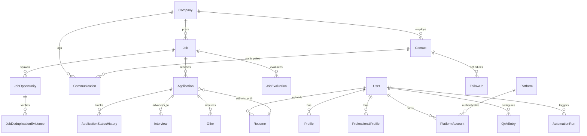

# JobPilot — Database Architecture & Backend Schema Specification

**Document Identifier:** `JOBPILOT-DOC-05-SCHEMA`  
**Classification:** Proprietary / Database Engineering Specification  
**Version:** 1.0.0-PROD  
**Target Release:** JobPilot v0.1.0-beta.1  
**Lead Architect:** Principal Database Engineer & Data Architect  
**Date:** November 2026  

---

## 1. Database Architecture & Engine Configuration

JobPilot utilizes SQLite 3.42+ as an embedded, zero-configuration relational persistence layer, interfaced through SQLAlchemy 2.0 ORM (`app/db/session.py` and `app/db/models/`).

### 1.1 Concurrency & Performance Tuning
To ensure robust concurrent access between background automation threads and the responsive PySide6 user interface, the SQLite engine is initialized with strict runtime PRAGMA directives:
```sql
PRAGMA journal_mode = WAL;          -- Write-Ahead Logging for non-blocking concurrent reads & writes
PRAGMA busy_timeout = 30000;        -- 30-second lock resolution threshold before busy exceptions
PRAGMA synchronous = NORMAL;        -- Balanced I/O performance while ensuring durability
PRAGMA foreign_keys = ON;           -- Enforce relational referential integrity at the database engine level
PRAGMA cache_size = -64000;         -- 64MB dedicated memory page cache
```

---

## 2. Entity-Relationship Diagram (ERD)

The complete relational data model connects user identity, parsed resumes, job queues, deterministic deduplication evidence, application lifecycles, interview stages, and recruiter communications.



---

## 3. Relational Table Specifications

### 3.1 Candidate & Identity Models (`User`, `Profile`, `ProfessionalProfile`)

#### `users` Table
Primary authentication and local desktop ownership entity.
- `id` (INTEGER, PK, Autoincrement)
- `email` (VARCHAR(255), Unique, Not Null)
- `username` (VARCHAR(100), Unique, Not Null)
- `password_hash` (VARCHAR(255), Nullable: local mode supports single-user unauthenticated auto-login)
- `is_active` (BOOLEAN, Default: True)
- `created_at` (DATETIME, Default: UTC Now)
- `updated_at` (DATETIME, Default: UTC Now)

#### `profiles` Table
Personal candidate facts and contact information.
- `id` (INTEGER, PK, Autoincrement)
- `user_id` (INTEGER, FK -> `users.id`, Unique, Not Null)
- `first_name` (VARCHAR(100), Not Null)
- `last_name` (VARCHAR(100), Not Null)
- `phone` (VARCHAR(50), Nullable)
- `location` (VARCHAR(200), Nullable)
- `headline` (VARCHAR(300), Nullable)
- `linkedin_url` (VARCHAR(500), Nullable)
- `github_url` (VARCHAR(500), Nullable)
- `portfolio_url` (VARCHAR(500), Nullable)
- `created_at` (DATETIME, Default: UTC Now)

#### `professional_profiles` Table
Domain credentials, salary boundaries, and availability facts used by Q&A Tier 1.
- `id` (INTEGER, PK, Autoincrement)
- `user_id` (INTEGER, FK -> `users.id`, Unique, Not Null)
- `total_experience_years` (FLOAT, Default: 0.0)
- `target_roles` (JSON / TEXT, Serialized list of target job titles)
- `skills` (JSON / TEXT, Serialized dictionary of technical and soft skills)
- `minimum_salary` (FLOAT, Nullable)
- `target_salary` (FLOAT, Nullable)
- `currency` (VARCHAR(10), Default: "USD")
- `notice_period_days` (INTEGER, Default: 0)
- `visa_status` (VARCHAR(100), Nullable)
- `requires_sponsorship` (BOOLEAN, Default: False)
- `willing_to_relocate` (BOOLEAN, Default: False)

---

### 3.2 Job Intelligence & Deduplication Models (`Job`, `JobOpportunity`, `JobDeduplicationEvidence`)

#### `jobs` Table
Core job listing entities ingested from web platforms and ATS portals.
- `id` (INTEGER, PK, Autoincrement)
- `company_id` (INTEGER, FK -> `companies.id`, Nullable)
- `title` (VARCHAR(255), Not Null)
- `company_name` (VARCHAR(255), Not Null, Indexed)
- `location` (VARCHAR(255), Nullable)
- `remote_type` (VARCHAR(50), Nullable: 'REMOTE', 'HYBRID', 'ONSITE')
- `job_url` (VARCHAR(1000), Not Null)
- `clean_url` (VARCHAR(1000), Not Null)
- `job_fingerprint` (VARCHAR(64), Unique, Not Null, Indexed): SHA-256 hash of `normalized_title + company_name + clean_url`.
- `description` (TEXT, Nullable)
- `source_platform` (VARCHAR(50), Not Null: 'LINKEDIN', 'NAUKRI', 'INDEED', 'UNIVERSAL')
- `posted_date` (DATETIME, Nullable)
- `created_at` (DATETIME, Default: UTC Now, Indexed)

#### `job_opportunities` Table
Tracks discovered candidates for application and deduplication status.
- `id` (INTEGER, PK, Autoincrement)
- `job_id` (INTEGER, FK -> `jobs.id`, Not Null)
- `status` (VARCHAR(50), Default: 'DISCOVERED'): Enum (`DISCOVERED`, `EVALUATED`, `QUALIFIED`, `REJECTED`, `APPLIED`)
- `match_score` (FLOAT, Default: 0.0)
- `dedup_decision` (VARCHAR(50), Default: 'UNIQUE'): Enum (`UNIQUE`, `DUPLICATE_EXACT`, `DUPLICATE_FUZZY`, `CANONICAL`)
- `confidence_level` (VARCHAR(50), Default: 'HIGH')
- `created_at` (DATETIME, Default: UTC Now)

#### `job_deduplication_evidence` Table
Forensic audit trail of deduplication decisions across multiple listings.
- `id` (INTEGER, PK, Autoincrement)
- `opportunity_id` (INTEGER, FK -> `job_opportunities.id`, Not Null)
- `canonical_job_id` (INTEGER, FK -> `jobs.id`, Nullable)
- `similarity_score` (FLOAT, Not Null)
- `matching_criteria` (JSON / TEXT, Reasons for deduplication decision)
- `evaluated_at` (DATETIME, Default: UTC Now)

---

### 3.3 Application Execution & Lifecycle Tracking (`Application`, `ApplicationStatusHistory`)

#### `applications` Table
Tracks submitted job applications and active platform processes.
- `id` (INTEGER, PK, Autoincrement)
- `job_id` (INTEGER, FK -> `jobs.id`, Not Null, Unique with user_id)
- `user_id` (INTEGER, FK -> `users.id`, Not Null)
- `resume_id` (INTEGER, FK -> `resumes.id`, Nullable)
- `platform` (VARCHAR(50), Not Null)
- `status` (VARCHAR(50), Default: 'APPLIED'): Enum (`SAVED`, `QUEUED`, `APPLYING`, `APPLIED`, `INTERVIEW`, `OFFER`, `REJECTED`, `FAILED`, `MANUAL_REQUIRED`)
- `applied_at` (DATETIME, Nullable)
- `confirmation_id` (VARCHAR(255), Nullable)
- `error_message` (TEXT, Nullable)
- `notes` (TEXT, Nullable)
- `created_at` (DATETIME, Default: UTC Now, Indexed)
- `updated_at` (DATETIME, Default: UTC Now)

#### `application_status_history` Table
Immutable historical log of all state transitions for an application.
- `id` (INTEGER, PK, Autoincrement)
- `application_id` (INTEGER, FK -> `applications.id`, Not Null, Indexed)
- `previous_status` (VARCHAR(50), Nullable)
- `new_status` (VARCHAR(50), Not Null)
- `change_source` (VARCHAR(50), Default: 'AUTOMATION'): Enum (`AUTOMATION`, `USER`, `EMAIL_SYNC`)
- `notes` (TEXT, Nullable)
- `changed_at` (DATETIME, Default: UTC Now)

---

### 3.4 Q&A Knowledge Graph & Learned Rules (`QnAEntry`)

#### `qna_entries` Table
Pre-approved answers and learned responses categorized by source provenance.
- `id` (INTEGER, PK, Autoincrement)
- `user_id` (INTEGER, FK -> `users.id`, Not Null)
- `question_pattern` (VARCHAR(500), Not Null, Indexed): Regex or normalized text string.
- `question_category` (VARCHAR(100), Default: 'GENERAL'): Enum (`EXPERIENCE`, `EDUCATION`, `SALARY`, `SPONSORSHIP`, `LEGAL`, `DEMOGRAPHIC`)
- `answer_value` (TEXT, Not Null)
- `answer_type` (VARCHAR(50), Default: 'TEXT'): Enum (`TEXT`, `NUMBER`, `BOOLEAN`, `CHOICE`, `MULTI_CHOICE`)
- `confidence_score` (FLOAT, Default: 1.0)
- `provenance` (VARCHAR(50), Default: 'QNA_RULE'): Enum (`PROFILE_FACT`, `RESUME_FACT`, `QNA_RULE`, `CALCULATED`, `LLM_FALLBACK`)
- `times_used` (INTEGER, Default: 0)
- `last_used_at` (DATETIME, Nullable)
- `created_at` (DATETIME, Default: UTC Now)

---

### 3.5 Networking & CRM Models (`Company`, `Contact`, `Communication`, `FollowUp`, `Interview`, `Offer`)

#### `companies` Table
- `id` (INTEGER, PK, Autoincrement)
- `name` (VARCHAR(255), Unique, Not Null, Indexed)
- `domain` (VARCHAR(255), Nullable)
- `industry` (VARCHAR(100), Nullable)
- `careers_url` (VARCHAR(500), Nullable)
- `notes` (TEXT, Nullable)

#### `contacts` Table
- `id` (INTEGER, PK, Autoincrement)
- `company_id` (INTEGER, FK -> `companies.id`, Nullable)
- `name` (VARCHAR(255), Not Null)
- `role` (VARCHAR(255), Nullable)
- `email` (VARCHAR(255), Nullable)
- `linkedin_url` (VARCHAR(500), Nullable)
- `phone` (VARCHAR(50), Nullable)

#### `communications` Table
- `id` (INTEGER, PK, Autoincrement)
- `contact_id` (INTEGER, FK -> `contacts.id`, Nullable)
- `company_id` (INTEGER, FK -> `companies.id`, Nullable)
- `channel` (VARCHAR(50), Not Null): Enum (`EMAIL`, `LINKEDIN_MESSAGE`, `PHONE`, `IN_PERSON`)
- `direction` (VARCHAR(20), Not Null): Enum (`OUTBOUND`, `INBOUND`)
- `subject` (VARCHAR(300), Nullable)
- `content` (TEXT, Nullable)
- `sent_at` (DATETIME, Default: UTC Now)

#### `interviews` Table
- `id` (INTEGER, PK, Autoincrement)
- `application_id` (INTEGER, FK -> `applications.id`, Not Null)
- `round_number` (INTEGER, Default: 1)
- `interview_type` (VARCHAR(50), Default: 'TECHNICAL'): Enum (`RECRUITER_SCREEN`, `TECHNICAL`, `SYSTEM_DESIGN`, `BEHAVIORAL`, `EXECUTIVE`, `OFFER_MEETING`)
- `scheduled_at` (DATETIME, Not Null)
- `duration_minutes` (INTEGER, Default: 45)
- `meeting_link` (VARCHAR(500), Nullable)
- `interviewer_names` (TEXT, Nullable)
- `prep_notes` (TEXT, Nullable)
- `feedback` (TEXT, Nullable)
- `status` (VARCHAR(50), Default: 'SCHEDULED'): Enum (`SCHEDULED`, `COMPLETED`, `CANCELLED`, `RESCHEDULED`)

---

## 4. Integrity Constraints & Critical Indexes

```sql
-- Enforce unique job ingestion via computed SHA-256 fingerprint
CREATE UNIQUE INDEX idx_jobs_fingerprint ON jobs(job_fingerprint);

-- Fast lookup for application status history
CREATE INDEX idx_app_status_history_app_id ON application_status_history(application_id);

-- Rapid deduplication check by company and normalized title
CREATE INDEX idx_jobs_company_title ON jobs(company_name, title);

-- Multi-tenant user isolation indexes
CREATE INDEX idx_applications_user_platform ON applications(user_id, platform);
CREATE INDEX idx_qna_entries_user_pattern ON qna_entries(user_id, question_pattern);
```

