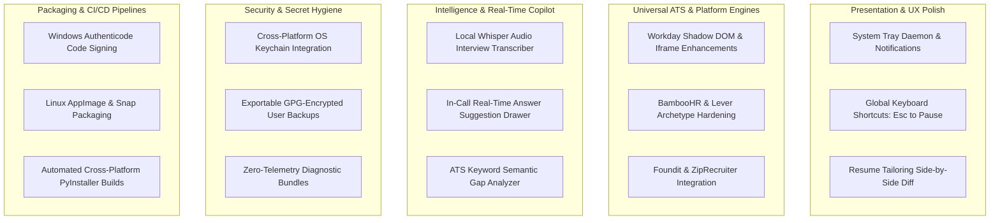
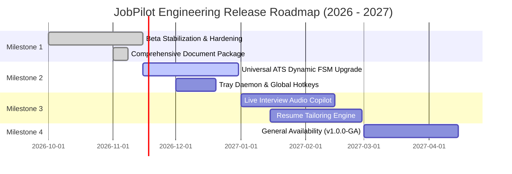
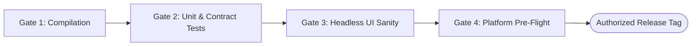

# JobPilot — Implementation Plan & Engineering Roadmap

**Document Identifier:** `JOBPILOT-DOC-06-PLAN`  
**Classification:** Proprietary / Engineering Strategy  
**Version:** 1.0.0-PROD  
**Target Release:** JobPilot v0.1.0-beta.1  
**Lead Architect:** Principal Engineering Program Manager  
**Date:** November 2026  

---

## 1. Executive Implementation Audit

This document establishes the verified implementation baseline of JobPilot, assesses outstanding technical debt, and defines the phased development plan transitioning the desktop client from its current hardened Beta milestone into full General Availability (GA).

### 1.1 Implementation Reality Matrix

| Subsystem | Implemented & Verified in Code | Missing / Proposed Work | Readiness Level |
|---|---|---|---|
| **Desktop Presentation** | 13 PySide6 Views, `ThemeManager`, `AppState` Signal Bus, High DPI scaling, Toast alerts. | System tray background minimization icon menu, keyboard shortcut map dialog. | **92% (Production Ready)** |
| **Domain Services** | 24 Services (`JobService`, `ApplicationService`, `QnAService`, `SecretsService`, etc.). | Automated resume tailoring engine for bespoke job variants. | **90% (Production Ready)** |
| **Persistence Layer** | 16 SQLAlchemy Models, SQLite 3 WAL Mode, Scoped Session managers, Migration seeds. | Automated weekly SQLite database compaction and vacuuming cron. | **95% (Production Ready)** |
| **Platform Automation** | LinkedIn Easy Apply, Naukri, Indeed, Glassdoor drivers, Universal ATS 12-state FSM. | BambooHR archetype driver, Workday multi-page nested iframe shadow DOM bypass. | **85% (Beta Hardened)** |
| **Q&A & Intelligence** | 5-Tier Provenance Resolver, Local facts, Rule caching, Multi-LLM provider client. | Local Whisper audio transcription for real-time live interview coaching. | **88% (Beta Hardened)** |
| **Security & Vault** | Fernet AES-256 credential encryption, `LogSanitizer`, zero-hallucination safe mode. | Hardware security key (YubiKey / WebAuthn) master unlock integration. | **95% (Production Ready)** |

---

## 2. Technical Debt & Architectural Risks

### 2.1 Identified Technical Debt
1. **Dynamic ATS DOM Drifts:** External job platforms (particularly Workday and LinkedIn) alter front-end class names and component structures bi-weekly. Automation drivers require resilient XPath heuristics over brittle class selectors.
2. **QThread Cleanup in Fast Exit Scenarios:** Fast desktop closures during active Selenium operations can produce orphaned ChromeDriver background processes if not caught by `ApplicationLifecycleManager`.
3. **Synchronous File Parsing in ResumesView:** Large multi-megabyte PDF and DOCX uploads temporarily block when parsed directly; these must be routed through background worker tasks.

### 2.2 Risk Assessment & Mitigation Matrix

| Identified Risk | Severity | Probability | Automated Mitigation Protocol |
|---|---|---|---|
| **Platform Anti-Bot Challenge** | High | Medium | Immediate fail-closed stop; sound desktop chime; delegate challenge to user. |
| **Platform Credential Invalidation** | Medium | Medium | Catch auth redirect; prompt re-login via UI; disable platform runner safely. |
| **SQLite Concurrency Lock contention** | Low | Low | Enforced `WAL` mode and `PRAGMA busy_timeout = 30000ms`. |
| **LLM Rate-Limit / Quota Exhaustion** | Medium | High | Fall back to deterministic Q&A rules (Tiers 1–4) and request human checkpoint. |
| **Unintended Mass Submissions** | Critical | Low | Safe Mode enabled by default; strict daily application quotas enforced per platform. |

---

## 3. Work Breakdown Structure (WBS) & Development Tracks

The engineering roadmap is organized into 5 parallel execution tracks:

---

## 4. Phased Milestone Roadmap

### 4.1 Milestone 1: Beta Stabilization & Hardening (Current)
- Complete comprehensive product documentation package (PRD, TRD, App Flow, UI/UX Design Brief, Backend Schema, Implementation Plan).
- Validate 100% test pass rate across unit, contract, and offscreen GUI headless suites.
- Enforce strict author identity and commit discipline.

### 4.2 Milestone 2: Universal ATS & Engine Expansion (Q4 2026)
- Expand Universal ATS FSM to support multi-page Workday applications with nested iframes.
- Implement system tray background execution mode with native desktop toasts.
- Add global emergency stop hotkey (`Ctrl+Shift+X` or `Cmd+Shift+X`).

### 4.3 Milestone 3: AI Interview Copilot & Resume Tailoring (Q1 2027)
- Integrate local embedded Whisper models for non-cloud speech-to-text interview question capture.
- Real-time Q&A cheat sheet overlay presenting bulleted STAR-method talking points during interviews.
- Semantic resume variant generator generating tailored PDF resumes targeting specific job descriptions.

### 4.4 Milestone 4: General Availability & Cloud Sync (Q2 2027)
- Optional end-to-end encrypted peer-to-peer cloud sync for cross-device state management.
- Multi-language localization (Spanish, German, Japanese, French).
- Commercial code signing for Windows (SmartScreen clean) and macOS notarization.

---

## 5. Verification & Testing Strategy

To maintain enterprise-grade software stability, every pull request and release milestone must satisfy four strict verification gates:

1. **Gate 1 (Compilation):** Syntax compilation verification across all Python modules using `python -m py_compile`.
2. **Gate 2 (Unit & Contract Tests):** 100% test pass rate on automated test suite discovery (`python -m unittest discover -s tests`).
3. **Gate 3 (Headless UI Sanity):** Verification of PySide6 view instantiation, theme injection, and lifecycle cleanup via `python run_desktop.py --offscreen --test-run`.
4. **Gate 4 (Platform Pre-Flight):** Verification of platform driver configurations and credential vaults via `python runAiBot.py --platform naukri --check-config`.

