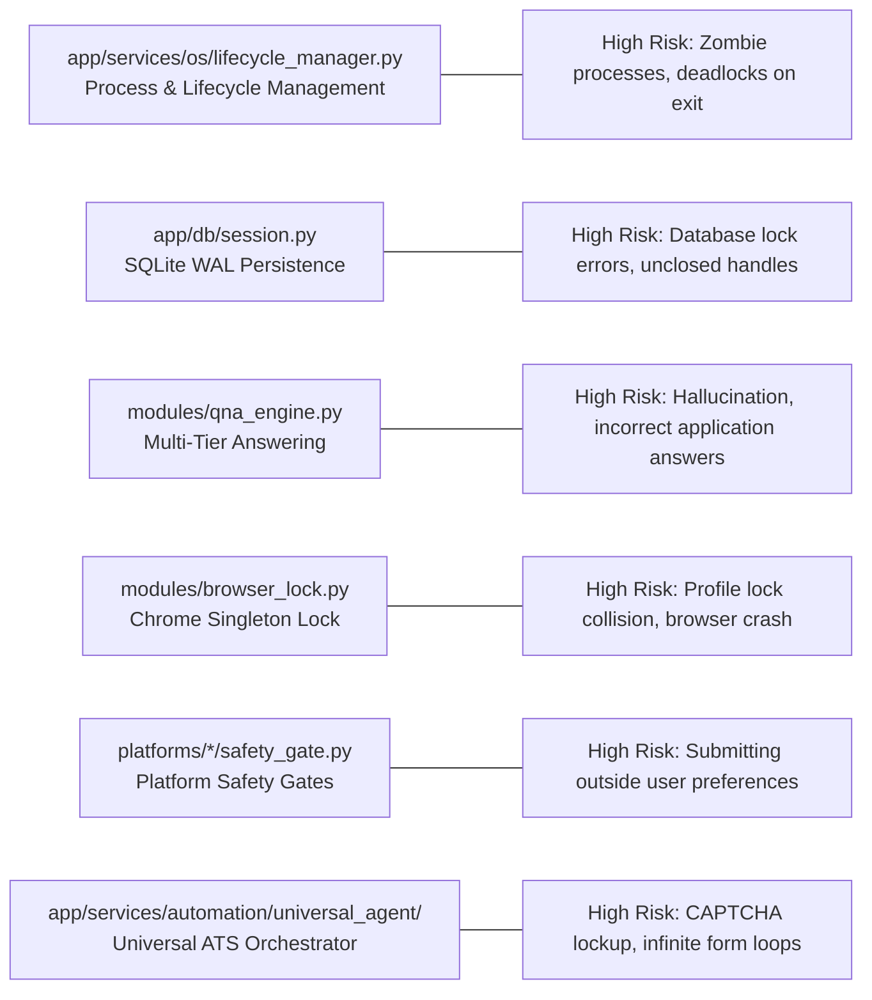

# JobPilot AI — Critical Modules & Failure Modes

**Document Version:** 1.0.0 (Phase 2 Baseline)  
**Target Repository:** `/home/ahmad10raza/Documents/Mastering/JobPilot`  
**Purpose:** Identify high-risk modules, single points of failure, concurrency hazards, and regression mitigation strategies.

---

## 1. High-Risk Subsystems & Modules

---

## 2. Critical Module Profiles

### 2.1 Application Lifecycle & Process Manager
- **Files:** `app/services/os/lifecycle_manager.py`, `app/services/os/process_manager.py`, `app/services/os/single_instance.py`
- **Responsibility:** Manages application startup, single-instance verification via lock file, graceful shutdown signaling, and safe child process termination across Windows and POSIX.
- **Critical Invariants:**
  - `closeEvent()` on `MainWindow` must have a bounded shutdown timeout (maximum 3-5 seconds).
  - Child processes (Chrome, ChromeDriver) must be cleanly terminated using `ProcessManager.kill_process_tree()` to avoid orphan zombies holding memory and profile locks.
- **Associated Tests:** `tests/test_os_compatibility_and_lifecycle.py`

---

### 2.2 Database Engine & Session Management
- **Files:** `app/db/session.py`, `app/db/base.py`, `modules/tracker.py`
- **Responsibility:** Multi-threaded SQLite persistence for job listings, application history, outreach logs, and user settings.
- **Critical Invariants:**
  - Must enforce SQLite WAL mode (`PRAGMA journal_mode = WAL;`, `PRAGMA busy_timeout = 30000;`, `PRAGMA synchronous = NORMAL;`).
  - No database transactions held open across browser operations or network calls.
  - Engines must be disposed via `dispose_engine()` on application exit to release file locks.
- **Failure Modes:** `sqlite3.OperationalError: database is locked` when sessions leak across threads.

---

### 2.3 Multi-Tier QnA Resolution Engine
- **Files:** `modules/qna_engine.py`, `modules/qualification_engine.py`, `app/services/resume_parser.py`
- **Responsibility:** Automatically answer screening questions (years of experience, citizenship, sponsorship, technical skills) during job applications.
- **Critical Invariants:**
  - Zero hallucination policy: Answers must strictly trace to verified profile facts (`config/profile.json`), parsed resume data, or explicit user QnA rules (`config/questions.py`).
  - If a required question cannot be resolved with high confidence, the system must trigger a Human-in-the-Loop intervention (`STATUS_UNKNOWN` or `MANUAL_REQUIRED`), never guess.
- **Associated Tests:** `tests/test_qualification.py`, `tests/test_qna_engine.py`

---

### 2.4 Browser Profile & Singleton Lock Manager
- **Files:** `modules/browser_lock.py`, `modules/open_chrome.py`
- **Responsibility:** Manages persistent Chrome profiles (`data/profiles/`) ensuring logins (LinkedIn, Naukri, Indeed) remain active between runs without repeated credential prompts.
- **Critical Invariants:**
  - Before launching Chrome, verify that no stale `SingletonLock` file exists.
  - Verify PID liveness via `ProcessManager.is_pid_alive` before unlinking lock files to prevent corrupting active sessions.
- **Failure Modes:** Chrome fails to launch or crashes silently due to profile lock contention.

---

### 2.5 Platform Safety Gates & Human-in-the-Loop
- **Files:** `platforms/naukri/safety_gate.py`, `platforms/indeed/safety_gate.py`, `modules/captcha_detector.py`
- **Responsibility:** Pre-submission verification ensuring candidate criteria match the job (title, salary, notice period, location) and detecting CAPTCHA / 2FA challenges.
- **Critical Invariants:**
  - Strictly prohibit automated CAPTCHA bypass or stealth evasion.
  - When a CAPTCHA or 2FA challenge is detected, pause automation immediately, notify the user, and present a Human-in-the-Loop dialog.
- **Associated Tests:** `tests/test_indeed_captcha.py`, `tests/test_indeed_safety_gate.py`, `tests/test_unified_hitl.py`

---

### 2.6 Universal Agent Orchestrator
- **Files:** `app/services/automation/universal_agent/orchestrator.py`, `form_filler.py`, `page_classifier.py`
- **Responsibility:** Handles unstructured or external ATS application forms (Workday, Greenhouse, Lever, SuccessFactors).
- **Critical Invariants:**
  - Bounded iteration loops: Maximum 10-15 step transitions per application to prevent infinite next-button cycles.
  - Result verification: Strict validation of confirmation screens before recording successful submission.
- **Associated Tests:** `tests/test_universal_orchestrator.py`, `tests/test_universal_state_machine.py`

