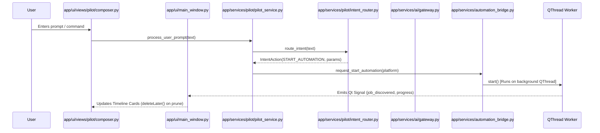

# JobPilot AI — Module Dependencies & Call Hierarchy

**Document Version:** 1.0.0 (Phase 2 Baseline)  
**Target Repository:** `/home/ahmad10raza/Documents/Mastering/JobPilot`  
**Analysis Source:** Codebase AST, Graphify Knowledge Graph (`graphify-out/graph.json`), and Unit Tests

---

## 1. Layer Dependency Hierarchy

JobPilot enforces a strict directional dependency rule:
```
Presentation Layer (UI / CLI)
          │
          ▼
    Service Layer
          │
          ▼
   Domain & Engines
          │
          ▼
Persistence & Infrastructure
```

**Architectural Invariant:** Dependencies may only point downward. Lower-tier components must never import or invoke higher-tier UI components.

---

## 2. Subsystem Dependency Call Graphs

### 2.1 UI to Service Communication Flow



### 2.2 Automation Engine & Decision Pipeline Flow

```mermaid
flowchart TD
    Router[platforms/router.py] --> Rotator[platforms/*/rotator.py]
    Rotator --> Browser[modules/open_chrome.py / browser.py]
    Rotator --> Parser[platforms/*/parser.py]
    Rotator --> QualEngine[modules/qualification_engine.py]

    QualEngine -->|Reject| TrackerSkip[modules/tracker.py (mark_skipped)]
    QualEngine -->|Approve| Applier[platforms/*/applier.py]

    Applier --> SafetyGate[platforms/*/safety_gate.py]
    SafetyGate -->|Reject| TrackerSkip
    SafetyGate -->|Approve| FormFiller[platforms/*/form.py]

    FormFiller --> QnAEngine[modules/qna_engine.py]
    QnAEngine --> Tier1[1. Profile Facts: config/profile.json]
    Tier1 -->|Not Found| Tier2[2. Resume Facts: app/services/resume_parser.py]
    Tier2 -->|Not Found| Tier3[3. QnA Rules: config/questions.py]
    Tier3 -->|Not Found| Tier4[4. AI Gateway: app/services/ai/gateway.py]

    FormFiller --> Submitter[platforms/*/submitter.py]
    Submitter --> TrackerSubmit[modules/tracker.py (mark_applied)]
    TrackerSubmit --> DB[(data/jobpilot.db)]
```

---

## 3. Module Dependency Matrix

| Source Module | Permitted Dependencies | Forbidden Dependencies | Notes |
| :--- | :--- | :--- | :--- |
| **`app/ui/`** | `app/services/`, `app/ui/theme.py`, `PySide6` | Raw SQLite connections, `selenium.webdriver`, `platforms/*` directly | All business actions routed through Services or Qt Signals. |
| **`app/services/`** | `app/db/`, `app/repositories/`, `modules/`, `platforms/router.py` | `PySide6.QtWidgets` (GUI elements) | Services must remain headless-compatible. |
| **`platforms/*`** | `modules/`, `config/`, `selenium`, `app/services/os/process_manager.py` | `app/ui/` (Direct widget manipulation) | Platform engines emit events or callbacks; no UI coupling. |
| **`modules/qna_engine.py`** | `config/`, `modules/helpers.py`, `app/services/ai/gateway.py` | `selenium.webdriver`, `app/ui/` | Pure decision engine; takes question text, returns answer. |
| **`app/db/`** | `sqlalchemy`, `sqlite3`, `app/db/models/` | `selenium`, `PySide6`, `platforms/*` | Isolated data persistence layer. |

---

## 4. Cross-Module Boundaries and Prohibited Calls

1. **No UI-Thread Blocking:**
   Calling `requests.get()`, `gateway.generate_answer()`, `driver.find_element()`, or `time.sleep()` inside any `QWidget` event handler is strictly prohibited.
2. **Short-Lived Database Transactions:**
   Holding a SQLAlchemy session or SQLite transaction open while awaiting network I/O, LLM completion, or browser page load is strictly prohibited. Connections must be acquired via `get_db_session()` context manager and closed immediately.
3. **No Direct OS Kill Calls:**
   Direct execution of `os.kill()` or `signal.SIGKILL` without verifying platform support is prohibited. All process teardown must pass through `ProcessManager.safe_terminate_process()` or `ProcessManager.kill_process_tree()`.

