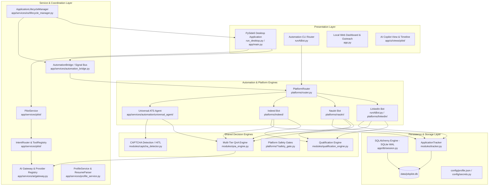

# JobPilot AI — System Architecture Overview

**Document Version:** 1.0.0 (Phase 2 Baseline)  
**Target Application:** JobPilot AI Desktop & Multi-Platform Automation Engine  
**Runtime:** Python 3.11.16 | PySide6 | SQLite (WAL Mode) | Selenium WebDriver  
**Primary Repository:** `/home/ahmad10raza/Documents/Mastering/JobPilot`

---

## 1. Executive Summary

JobPilot AI is a local-first, multi-platform desktop application designed to streamline and automate job discovery, qualification, and application processes across multiple employment platforms (LinkedIn, Naukri, Indeed, Glassdoor, and Foundit), alongside direct-application Universal ATS forms (Workday, Greenhouse, Lever, Taleo, iCIMS, SuccessFactors).

The system is architected as an asynchronous, thread-isolated desktop client featuring a modern PySide6 GUI, backed by a persistent SQLite database operating in Write-Ahead Logging (WAL) mode, a local/multi-provider AI Gateway, and platform-specific browser automation drivers.

---

## 2. High-Level System Architecture

---

## 3. Four-Tier Architectural Model

### Tier 1: Presentation Layer
- **Desktop GUI (`app/ui/`):** Built with PySide6 (Qt for Python). Contains `MainWindow`, dynamic navigation sidebars, view stacks (`AutomationView`, `PilotView`, `AnalyticsView`, `SettingsView`), and theme management (`ThemeManager`).
- **Web Dashboard (`app.py`):** Flask-based dashboard exposing REST endpoints for applied job history, outreach metrics, and local analytics.
- **CLI Driver (`runAiBot.py`):** Command-line router capable of launching headless or windowed platform automations with command-line arguments (`--platform`, `--check-config`).

### Tier 2: Service & Coordination Layer
- **`PilotService` (`app/services/pilot/pilot_service.py`):** In-memory copilot orchestrator managing conversations, timeline cards, rule changes, intervention requests, and event broadcasting.
- **`IntentRouter` & `ToolRegistry` (`app/services/pilot/`):** Natural language intent classification routing user prompts to platform actions, status checks, profile autofill, or QnA management.
- **`ApplicationLifecycleManager` (`app/services/os/lifecycle_manager.py`):** Coordinates graceful startup, clean thread termination, child process cleanup, and bounded UI exit timeouts (3-5 seconds max).
- **`AI Gateway` (`app/services/ai/`):** Unified interface supporting local providers (Ollama) and cloud APIs (Gemini, OpenAI, Claude, DeepSeek) with defensive prompt guarding and schema validation.

### Tier 3: Automation & Platform Drivers
- **Platform Router (`platforms/router.py`):** Dispatches job search, parsing, qualification, and application requests to the active platform driver.
- **Platform Engines:**
  - `platforms/linkedin/`: LinkedIn Easy Apply automation, modal form navigation, and search rotation.
  - `platforms/naukri/`: 12-phase pipeline with pre-click classification, questionnaire handling, and search rotation.
  - `platforms/indeed/`: Indeed automation, form navigation, screening questions, and safety gates.
  - `platforms/glassdoor/` & `platforms/foundit/`: Platform-specific job discovery and apply drivers.
- **Universal Agent (`app/services/automation/universal_agent/`):** Form analysis, stagehand agent, field classification, and human-in-the-loop intervention for external ATS forms.

### Tier 4: Core Shared Engines & Persistence
- **Multi-Tier QnA Engine (`modules/qna_engine.py`):** Tier 1 (deterministic candidate profile facts) -> Tier 2 (managed resume facts) -> Tier 3 (explicit QnA rules) -> Tier 4 (AI fallback). Zero hallucination.
- **Qualification Engine (`modules/qualification_engine.py`):** Filters job listings against user criteria (experience ranges, salary thresholds, forbidden titles, excluded companies).
- **Persistence (`app/db/session.py`, `modules/tracker.py`):** SQLite database configured with `PRAGMA journal_mode = WAL;`, `PRAGMA busy_timeout = 30000;`, and short-lived transactional sessions.

